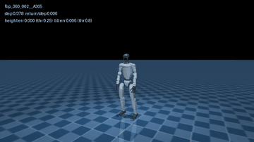
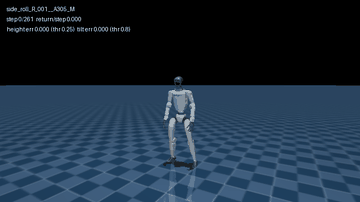
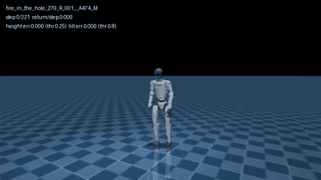
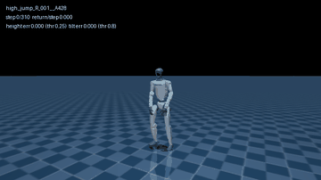
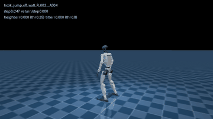
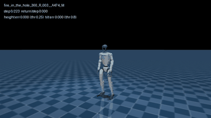
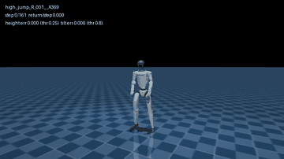
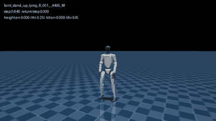

# SuperMimic-Rep

A paper-faithful reproduction of **SuperMimic: Scaling Humanoid Whole-Body Control with One Differentiable World
Model** ([arXiv:2610.28480](https://arxiv.org/abs/2610.28480), CoRL 2026): a learned differentiable world model plus a
short-horizon BPTT actor-critic for whole-body motion tracking on the Unitree G1, built on
[mjlab](https://github.com/mujocolab/mjlab) / MuJoCo Warp.

The goal is to match the paper's numbers on a single GPU under the paper's training and evaluation protocol. **All
results are compared at the same training progress (iterations = updates)**; wall-clock time is reported alongside but
is never the basis of a comparison (see `docs/CONTRACTS.md`).

This repository is forked from [CuboiLeo/SuperMimic-Reproduced](https://github.com/CuboiLeo/SuperMimic-Reproduced)
(MIT). The upstream documents are kept read-only in `docs/upstream/`; the results quoted there were obtained by the
upstream author on RTX 5090s under the upstream protocol and are not results of this repository. Project
documentation under `docs/` is written in Chinese.

## Status (2026-10-28)

Hardware: 1× RTX PRO 6000 Blackwell 96 GB. Iteration = one update (UTD 0.4, on average 2.5 simulator steps per
update). Return = the paper's normalized return (§4): reward sum / (0.1 × number of steps of the whole clip), evaluated
with the Appendix F.1 protocol (every clip played once from its first frame, deterministically). A motion fails when a
training termination condition fires.

### Against the paper

| Target (paper) | This repository | Status |
|---|---|---|
| BONES-SEED name filter: 129,667 clips | 129,667 | ✓ |
| BONES-SEED feasibility filter: 129,514 clips / 264.56 h | 129,511 / 263.08 h (thresholds not published; 3 clips off) | ≈ |
| World-model 8-step prediction error 0.007–0.011 | 0.008–0.010 | ✓ |
| LAFAN1 single-GPU return 0.82 (1.2 h on an H100) | 0.821 at 18,000 iterations (`anchor_ori_now`) | return ✓, takes longer |
| BONES-SEED single-GPU 3 h (≈ 100k iterations) return > 0.90 | 0.943 at 104,000 iterations (0.943 at 88,000) | ✓ |
| BONES-SEED single-GPU 3 h (≈ 100k iterations) failures 25 / 129,514 (SONIC: 179); Fig. A.1: 27 at 100k, about 30 at 88k | **21 / 129,511 at 104,000 iterations, 30 at 88,000** | ✓ at matched iterations (13.3 h instead of 3 h) |
| BONES-SEED single-GPU failures at 148k iterations: 14 (Fig. A.1, about 4.4 h); 6 at 320k | **14 / 129,511 at 148,000 iterations** (19 h); 320k running | ✓ at matched iterations |

The paper reports times, not iteration counts. Its Fig. A.1 (failures vs. wall-clock, one point every 4,000
iterations) has exactly 80 points on the 1-GPU curve, evenly spaced and ending at 9.37 h (the 2-GPU curve ends at
9.79 h, matching the text's 9.8 h): about 34k iterations per hour on one H100 (9.5 it/s), so **the paper's 3 h is
≈ 100k iterations**. Failures read off that curve (±3): 103 at 44k, about 30 at 88k, 27 at 100k, 14 at 148k, 6 at
320k. (An earlier estimate calibrated on LAFAN1 put 3 h at 37–44k iterations; it was wrong.)

### LAFAN1 (40 clips, 2.45 h; `anchor_ori_now` = paper observations + 6-D anchor orientation)

| Iteration | Return / failures (of 40) | Training time |
|---|---|---|
| 9,600 | 0.768 / 3 | 2.0 h (before the speed-up) |
| 16,000 | 0.796 / 1 (before the speed-up); 0.815 / 2 (after) | 3.4 h / about 1.8 h |
| 18,000 | **0.821 / 1** (before the speed-up) | 3.7 h; about 1.85 h after the speed-up |

With the paper's observation setting (`beyondmimic_seq`), the pre-speed-up code reached 0.763 / 1 failure in 2 h
(about 9.6k iterations), within noise of `anchor_ori_now` (0.766). Stopping at 0.77 after 2 h was a matter of too few
updates.

### Full BONES-SEED (129,511 clips, 263 h; `beyondmimic_seq` = paper observation setting)

| Iteration | Original reset sampler | Corrected sampler | Corrected sampler + critic fixes | + per-clip cap on the hard mass | Paper (1× H100, Fig. A.1) |
|---|---|---|---|---|---|
| 36,000 | 0.929 / 413 | 0.927 / 321 | – | – | – |
| 40,000 | 0.929 / 425 | 0.929 / 253 | – | – | – |
| 44,000 | 0.931 / 361 | 0.934 / 210 | 0.933 / 166 | 0.933 / 165 | 103 |
| 88,000 | – | 0.941 / 67 | 0.941 / 70 | **0.943 / 30** | about 30 |
| 104,000 | – | 0.939 / 58 | – | **0.943 / 21** | 27 at 100k |
| 148,000 | – | 0.918 / 80 | 0.891 / 125 | **0.943 / 14** | 14 |

Return / failures, same code apart from the named change, one seed each. The four columns are successive changes, each
compared with the previous one at the same iteration: the corrected sampler removed the clip-end artifact; the critic
fixes made no measurable difference at 44k / 88k but removed the NaN / divergence of long runs; the per-clip cap on the
hard-sampling mass (at most 1% per clip, see below) halved the failures from 88k on and brings them to the paper's
level at matched iterations. Side rolls and flips went from 54/54 and 22/22 failed (original sampler, 44k) to 0 failed
at 88k with the cap. The remaining failures at 104k are scattered (high jumps, fire-in-the-hole turns, a few lying /
resting clips, one dance). Per-group failures (paper Table A.8) come from `scripts/eval_groups.py`.

Without the cap the return dropped after 104k (standing motions drifted horizontally: 0.918 / 80 and 0.891 / 125 at
148k). With the cap it does not: 0.943 / 14 at 148k, long standing clips (`body_check`) at 0.970 instead of 0.83–0.87,
and the 14 failures match the paper's curve at the same iteration. The drop was a sampler effect (the hard mass moving
onto one unlearnable clip), not a learner problem. The run continues to 320k (paper: 6 failures).

#### Examples (104k iterations, per-clip cap run; reference motion as a translucent ghost, deterministic benchmark rollout)

| Success: flip 360 | Success: side roll | Success: fire-in-the-hole 270 | Success: high jump |
|---|---|---|---|
|  |  |  |  |

| Failure: hook jump off wall | Failure: fire-in-the-hole 360 | Failure: high jump (another take) | Failure: faint and stand up |
|---|---|---|---|
|  |  |  |  |

All four successes failed with the previous code at the same iteration. The overlay shows the step, the running
return per step and the two termination quantities (pelvis height error, threshold 0.25 m; tilt error, threshold 0.8);
the clip ends when one of them fires. Rendered with `scripts/render_video.py` (GIFs are downscaled to 360 px; successes at 12 fps,
at most 8 s; failures at 25 fps, the clip ends where the termination fires).

### Training speed (single GPU, iteration = update)

| Configuration | Upstream code | This repository |
|---|---|---|
| LAFAN1 (4096 environments, imagination batch 4096, H = 32) | 754 ms / iteration (1.33 it/s) | **371 ms / iteration (2.70 it/s)** |
| Full BONES-SEED | 1.2 it/s | **2.2–2.4 it/s** (paper: about 9.5 it/s on an H100, from Fig. A.1); 2.7 it/s with bf16 autocast (experimental, quality check running) |

Every speed-up was checked numerically on single updates, and training-level results were verified at matched
iterations (no systematic difference from the pre-speed-up code on LAFAN1 and BONES-SEED).

### Not yet reached / next steps

- At 44k iterations the failures are still 1.6× the paper's (165 vs. 103); from 88k on they match. Everything is one
  seed; the 44k failure count varied 166–210 across four earlier runs with the same code.
- The late return drop of earlier runs (after about 104k iterations) is gone with the per-clip cap; 148k: 0.943 / 14.
  Still to see: 200k–320k (paper: 6 failures at 320k).
- Training is about 4× slower per iteration than the paper's H100 numbers (13.3 h to 104k instead of 3 h). TF32 was
  already on (set by mjlab); about 150 ms of each 440 ms iteration is not GPU compute. bf16 autocast of the MLP hidden
  layers gives 2.7 it/s, but on its own it landed at the bad end of the single-seed range at 44k and 88k, so it is
  being re-run on top of the per-clip cap before it becomes the default.
- The paper does not give the grouping rules of Table A.8; the flips / lying / dance routine group sizes do not match.
- The imagination vs. MuJoCo Warp throughput benchmark (paper Fig. 5a) has not been run.
- All comparisons so far use a single seed.
- Out of scope for now: the velocity interface and distillation (§4.5), PPO baselines, the H × critic ablation,
  real-robot deployment.

## Changes from upstream

**Protocol alignment (paper appendices)**
- An iteration is one update (one world-model and one policy / critic update); the learning-rate schedule and
  checkpoint numbering follow it. Upstream counted one simulator step as one iteration.
- Four observation settings via `--env.obs-mode`: `beyondmimic_seq` (the paper's), `anchor_ori_now`, `proprio_only`
  (Table A.1 taken literally), `anchor_pose9`; simulator and imagined goals are checked element by element.
- Domain randomization is sampled at startup; the return denominator is the whole clip's length, so early failures
  score low.
- BONES-SEED: streaming conversion, a name filter from SONIC's keyword table plus extra terms (exactly 129,667 clips),
  the feasibility filter, and full benchmarks on a compact library.

**Upstream bugs fixed**
- The world model's termination labels were off by one step (the state before termination was labelled terminal).
- The quaternion error had NaN gradients at zero error (`torch.where` does not block NaN from the discarded branch).
- Resuming crashed on an empty replay buffer (warm-up collection now runs on every start).
- Non-finite gradient guard: a step with NaN / Inf gradients is skipped, leaving weights and optimizer state unchanged.

**Critic stability (not in the paper)**: long BONES-SEED runs went NaN (~152k iterations) or diverged (~196k).
- Critic values are clamped to ±G_max = max step reward / (1 − γ) = 10 where they are used (V_H and the GAE inputs),
  and GAE targets are clamped as the recursion goes.
- The critic is fit only on imagined samples still alive (survival ≥ 0.001): after a predicted fall the imagined
  rollout keeps running, actions and states blow up together (rewards down to −10³⁴), and an unweighted critic fit
  absorbed those samples. Dead samples are treated as terminated (reward 0, value 0), by substitution, not
  multiplication.
- The policy loss is the paper's −J rather than upstream's −J/H, so the Table A.5 clipping (global norm 1.0, then
  0.1 element-wise) actually fires; a critic minibatch with a non-finite gradient norm is skipped.
- Interval logs keep the max / min of tail statistics (`*_max` / `*_min`), which an interval mean dilutes.

**Return-based reset sampler**: each 1 s bin's estimate is now the return-to-go divided by the largest return
attainable from that step (a completion in [0, 1]). On 129k clips the original estimate gave 94% of the hard-sampling
mass to clip-end bins only a few frames long, so flips, side rolls and similar motions were never practiced.
A second, not-in-the-paper fix caps the hard-sampling mass per clip (`--env.hard-clip-cap`, default 1%, 0 = the paper's
formula): with the paper's sharp softmax (temperature 25 over about 1M bins) one clip that never improves (return
estimate about 0.2) took 76–96% of the hard mass for the whole run, and the motions that actually fail in the benchmark
received 0.5% of it. The excess is redistributed proportionally (closed-form water-filling), the memory term is updated
from the capped distribution, and two logs (`sampler/hard_top_clip_share`, `sampler/hard_eff_clips`) show the capture.

**Training speed**: fused Adam (and a fix for checkpoint loading silently turning fused off), sync-free non-finite
guards, the whole imagined step compiled into one graph and replayed with CUDA graphs, and the same for the world
model's 8-step window.

**Tools**: steady-state profiling (`scripts/perf/profile_train.py`), single-update parity checks
(`scripts/perf/update_parity.py`), a reset-sampler report (`scripts/sampler_report.py`), and headless MP4 rendering
with the reference shown as a translucent ghost and per-step termination errors (`scripts/render_video.py`).

## Quick start

### Environment

- Python 3.12 and `uv`; torch 2.14 (cu130), mujoco / mujoco-warp 3.16, warp-lang ≥ 1.15; mjlab pinned to commit
  `8bb2bc9` (`[tool.uv.sources]` in `pyproject.toml`).
- A CUDA GPU is required for training, evaluation and most tests; only some unit tests run on CPU.

```bash
uv sync --group dev
uv run pytest tests -q          # if your system PYTHONPATH carries another Python's packages, prefix env -u PYTHONPATH
```

### Data

- **LAFAN1**: 40 G1-retargeted CSV clips (HuggingFace `lvhaidong/LAFAN1_Retargeting_Dataset`) → 50 Hz npz (2.45 h).
- **BONES-SEED**: `g1.tar.gz` from HuggingFace `bones-studio/seed` (142,220 clips at 120 fps) → streamed to 50 Hz npz
  shards → name and feasibility filters (paper Appendix E) → an fp16 compact library (6.7 GB, resident on the GPU,
  reference body states computed online by FK).

```bash
uv run python scripts/data/csv_to_npz_batch.py --input-dir data/raw/lafan1/g1 --output-dir data/npz/lafan1 --input-fps 30 --workers 16
uv run python scripts/data/stream_bones_seed.py --help      # g1.tar.gz -> 50 Hz npz shards
uv run python scripts/data/filter_bones_seed.py --help      # name + feasibility filters -> keep list
uv run python scripts/data/build_library.py --help          # compact library (.pt)
uv run python scripts/data/make_subset.py --help            # evaluation subsets (e.g. 2000 clips)
```

`data/` and `logs/` are not tracked.

### Training

```bash
# LAFAN1, single GPU
uv run sm-train --run-name lafan1_seq --data.npz-dir data/npz/lafan1 --env.obs-mode beyondmimic_seq \
  --schedule.checkpoint-interval 2000

# Full BONES-SEED on the compact library, paper schedule (320k iterations)
uv run sm-train --run-name bones_seq --data.library data/library/bones_seed_compact.pt --env.obs-mode beyondmimic_seq \
  --schedule.checkpoint-interval 4000

# Multi-GPU: torchrun, one process per GPU (each rank has its own simulator and replay buffer; gradients are
# all-reduced; lr × sqrt(world size))
uv run torchrun --nproc_per_node 2 -m supermimic.scripts.train --run-name bones_seq_2gpu ...

# Also useful: --schedule.max-hours <h> (only decides when to stop; the LR schedule depends on iterations), --resume <ckpt>
```

Defaults follow the paper's Tables A.5 / A.6: 4096 environments, H = 32, UTD 0.4, γ = 0.99, critic 5 epochs × 4
minibatches, 10 batches × 2048 windows per world-model update, 320k iterations, cosine decay to 0.03×. Logs go to
TensorBoard (`logs/<run>/tb`).

### Evaluation and inspection

```bash
# Appendix F whole-clip benchmark
uv run python scripts/eval_benchmark.py --ckpt logs/lafan1_seq/ckpt_0018000.pt --npz-dir data/npz/lafan1
uv run python scripts/eval_benchmark.py --ckpt logs/bones_seq/ckpt_0044000.pt --library data/library/bones_seed_compact.pt

# Failures per motion group (paper Table A.8)
uv run python scripts/eval_groups.py --benchmark logs/bones_seq/benchmark_ckpt_0044000.json

# Where the reset sampler sends its resets (CPU only)
uv run python scripts/sampler_report.py --ckpt logs/bones_seq/ckpt_0044000.pt --library data/library/bones_seed_compact.pt

# MP4 with the reference ghost and per-step termination errors (EGL when there is no display)
MUJOCO_GL=egl uv run python scripts/render_video.py --ckpt logs/bones_seq/ckpt_0044000.pt \
  --library data/library/bones_seed_compact.pt --pattern '^flip_180_' --max-clips 3 --out videos/

# Interactive replay (MuJoCo window with a display, otherwise viser at http://localhost:8080)
uv run python scripts/play.py --ckpt logs/lafan1_seq/ckpt_latest.pt --clips dance1_subject1
```

## Repository layout

```
src/supermimic/
  config.py              training configuration (tyro CLI)
  data/                  CSV -> npz conversion, replay buffer
  envs/                  mjlab environment: motion library (incl. compact), multi-clip command with return-based
                         resets, observations, rewards, terminations
  kinematics/            differentiable G1 forward kinematics, rotation utilities
  world_model/           world model (dynamics MLP, learned termination head, analytic observation / reward heads)
                         and its trainer
  imagination/           imagined rollouts (whole step compiled + CUDA graphs), goals, Eq. 2 objective,
                         policy / critic trainer
  policy/                policy (motion encoder + decoder) and critic
  training/              main loop, multi-GPU, LR schedule, optimizer utilities
  eval/                  Appendix F benchmark
scripts/                 data preparation, evaluation, grouping, visualization, performance tools
tests/                   unit and GPU integration tests (reward / observation parity, world model, imagination, sampler)
docs/                    project documentation (below)
```

## Documentation (in Chinese)

| File | Contents |
|---|---|
| `docs/PROJECT.md` | Overview, modules, feature status |
| `docs/CONCEPTS.md` | Terms: normalized return, failed motion, observation settings, iterations and UTD, return-based sampling, imagination |
| `docs/CONTRACTS.md` | Hard rules: reporting and comparing with the paper, benchmark protocol, numerical conventions |
| `docs/experiences/` | Pitfalls and reusable lessons (`INDEX.md`) |
| `docs/changes/archive/` | Design, plan, review and validation of every change (by change ID) |
| `docs/upstream/` | The upstream repository's original documents (read-only reference) |

Development follows ChangeFlow (`AGENTS.md`): each change gets a design and a plan, then implementation, review and
validation before it is archived.

## Acknowledgements and license

- Upstream implementation: [CuboiLeo/SuperMimic-Reproduced](https://github.com/CuboiLeo/SuperMimic-Reproduced) (Yuxi Liu).
- Simulation and the tracking task: [mjlab](https://github.com/mujocolab/mjlab), MuJoCo Warp.
- Data: LAFAN1 (G1-retargeted), BONES-SEED (bones-studio).
- Paper: Qiayuan Liao et al., *SuperMimic: Scaling Humanoid Whole-Body Control with One Differentiable World Model*,
  CoRL 2026.

MIT License, see `LICENSE` (the upstream copyright notice is kept).
